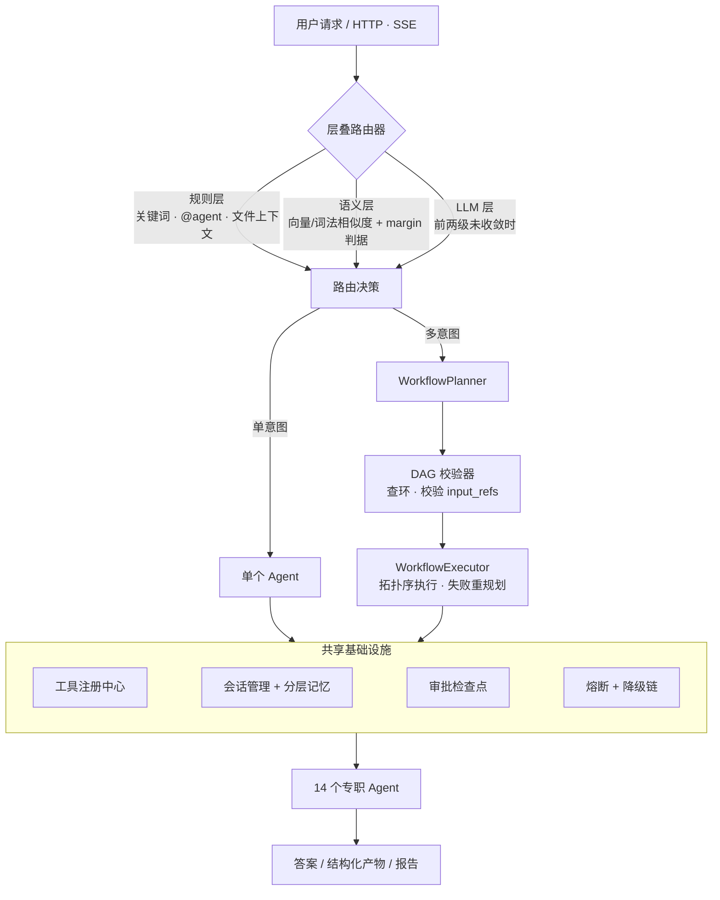
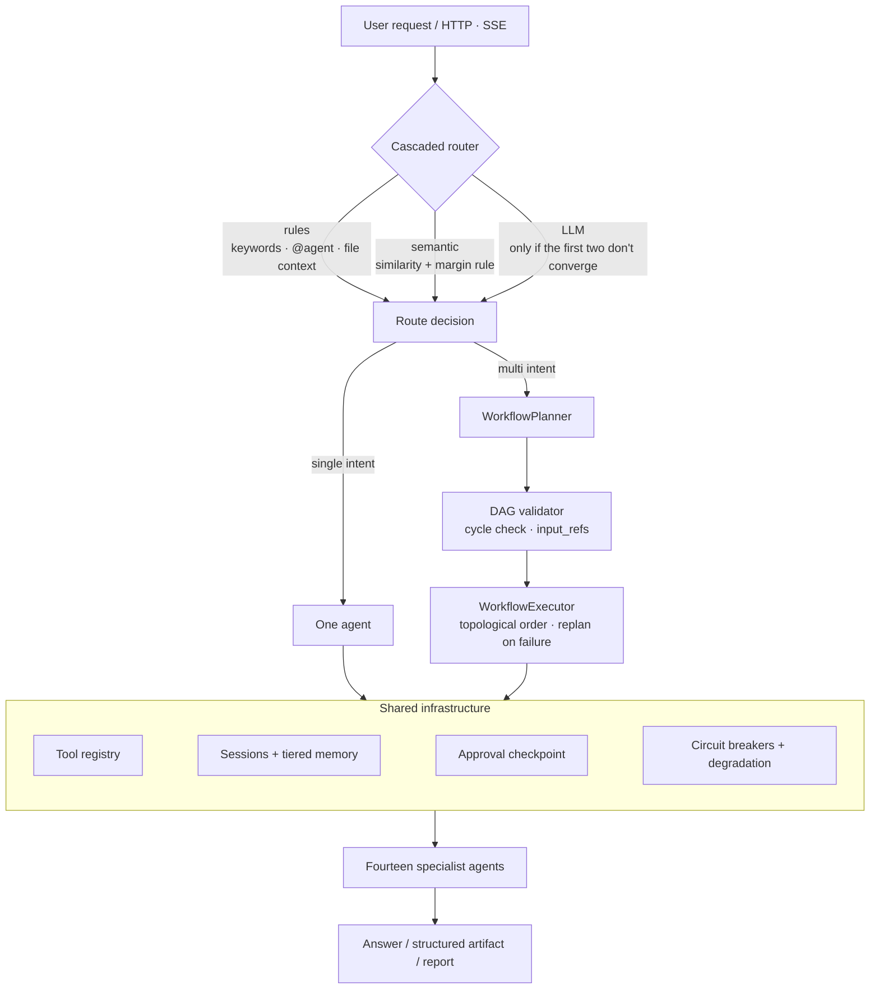

# Mini Thalamus

[](https://github.com/petersong2003514-sys/mini-thalamus/actions/workflows/ci.yml)

**一个以路由为核心的多 Agent 平台。** 用户的每个请求先经过 规则 → 语义 → LLM 三级层叠路由，被分派给 14 个专职 Agent 之一；多意图请求会被拆成 DAG 顺序执行；所有会触碰外部世界的操作都要过同一个审批检查点。

**A router-first multi-agent platform.** Every request goes through a rules → semantic → LLM cascade that dispatches it to one of fourteen specialist agents. Multi-intent requests become a DAG that executes in dependency order, and every operation that touches the outside world passes the same approval checkpoint.

[中文](#中文) · [English](#english)

---

## 中文

### 为什么叫 Thalamus

丘脑是大脑的中继站：它接收来自各处的信号，判断每个信号该交给哪块皮层，并决定什么允许通过。这个项目做的就是同一件事——**一个层叠路由器负责分派，一个审批检查点负责放行。**

### 它是什么

- **层叠路由**：规则层（关键词/`@agent` 指令/文件上下文）→ 语义层（不依赖 torch 的默认后端，或可切换 sentence-transformers）→ LLM 层。每一级都有明确的收敛条件，命中即停，不命中才下沉。
- **14 个专职 Agent**：NL2SQL、RAG、代码沙箱、文档解析、联网搜索、网页抓取、深度研究、数据洞察、报告生成、图像理解、API 调用、浏览器自动化、Shell、通用兜底。
- **DAG 编排**：多意图请求先规划成有依赖关系的工作流，经 DAG 校验器查环后按拓扑序执行，步骤间用 `input_refs` 传递结构化产物。
- **共享基础设施**：统一工具注册中心（发现 + schema 校验 + 分级重试）、跨 Agent 会话管理、分层记忆、熔断与降级链、标准化的 Agent 通信协议。
- **运行时热插拔**：Agent 可在不重启进程的情况下注册、更新、注销（见 [examples/demo_hot_plug.py](examples/demo_hot_plug.py)）。
- **可选的自我进化**：失败归因 → 生成补丁 → 守卫评测 → 应用或回滚。

### 它不是什么

这不是一个"框架"。它没有试图抽象出一套通用的 Agent 接口去兼容所有人，而是一个把 14 个真实能力接完整、并且**在公开基准上跑出过可复核分数**的完整系统。代价是它有明确的取向（Web 优先、中文优先、多意图优先），不是通用积木。

### 架构



*Agent 的具体名单、关键词和图标在 [config.py](src/mini_thalamus/config.py) 的 `_BUILTIN_ROUTER_AGENTS`；运行时会被 AgentRegistry 发现的 Skill / MCP / 动态 Agent 合并覆盖。*

### 快速开始

```bash
git clone <repo> && cd mini-thalamus
python -m venv .venv && . .venv/bin/activate     # Windows: .venv\Scripts\activate
pip install -e .

cp .env.example .env        # 填入 DEEPSEEK_API_KEY，其余键都有可用默认值
python -m mini_thalamus     # → http://127.0.0.1:8765
```

**前端已经预构建好了**（[src/mini_thalamus/static/](src/mini_thalamus/static/) 随包分发），所以**不需要装 Node** 就能跑。只有要改前端时才需要：

```bash
cd src/mini_thalamus/web && npm install && npm run build
```

四种等价的启动方式：

```bash
python -m mini_thalamus                        # 最简
python -m mini_thalamus.web_server
mini-thalamus                                  # console script
uvicorn mini_thalamus.web_server:app --port 8765
```

命令行版本（不启 Web）：

```bash
python -m mini_thalamus.main "北京用户买得最多的品类是什么？"
python -m mini_thalamus.main --multi "分析销售趋势并出图"
mini-thalamus-nl2sql --help                    # 独立的 NL2SQL CLI
```

### 可选依赖

核心依赖只覆盖服务端和路由真正会 import 的东西。重的一律按需安装：

```bash
pip install -e ".[docparse]"    # PDF/Word/Excel 解析
pip install -e ".[vision]"      # 本地 OCR（会拉 torch）
pip install -e ".[semantic]"    # 向量语义路由（会拉 torch）
pip install -e ".[browser]"     # 无头 Chromium
pip install -e ".[evals]"       # 下载外部基准语料
```

没装的 extras 对应的 Agent 会**注册为不可用**并在路由中被跳过，不会让进程起不来。

### 配置

全部环境变量、默认值和取值说明都在 [.env.example](.env.example)。两个约定：

- 本项目自己的变量统一用 `MT_` 前缀（`MT_ROUTER_SEMANTIC_THRESHOLD`、`MT_SANDBOX_USE_DOCKER` …）。
- 属于第三方的键保留厂商原名：`DEEPSEEK_API_KEY`、`TAVILY_API_KEY`、`NL2SQL_*`。

读取顺序：`$MT_ENV_FILE` → 当前工作目录的 `.env` → 包目录的 `.env`；先定义者优先，真实环境变量永远覆盖文件。

### 测试

```bash
pip install -e .
python -m unittest discover -s tests -p "test_*.py"
python scripts/check_imports.py     # 全树 import 冒烟：单元测试覆盖不到的模块
```

**293 个测试，全部通过**——这个数字是机器实测的，不是文档里的声明，CI 每次提交都会重跑。测试覆盖路由决策、DAG 校验与编排、记忆与并发、熔断与执行策略、各 Agent 的契约与边界条件。

CI 在 Ubuntu（3.10 / 3.12）和 Windows（3.12）上各跑一遍，装的是**最小依赖**——因为 README 让读者装的就是最小依赖。

要求 Python **3.10+**。

### 评测

跑在**官方 checker 和官方数据**上（vendored 自 `bfcl-eval`，见 [NOTICE](NOTICE)）。以下全部是**单次运行、无 seed、无方差报告**的结果——把这条读进结论里。

| 基准 | 子集 | 指标 | 结果 | 备注 |
|---|---|---|---|---|
| BFCL v4 | `simple_python` | pass_rate | **1.00** | 官方 AST checker，50 条 |
| BFCL v4 | `multiple` | pass_rate | **1.00** | |
| BFCL v4 | `parallel` / `parallel_multiple` | pass_rate | **0.80 / 1.00** | 5 条，样本极小 |
| BFCL v4 | `multi_turn_*`（官方多步执行） | pass_rate | **0.67 / 0.67 / 0.67 / 0.33** | 每类仅 3 条冒烟 |
| BFCL v4 | `web_search` | pass_rate | **0.20** | ⚠️ 见下 |
| Spider | dev（100 条分层 / 20 库） | execution accuracy | **0.93** | |
| BEIR | `nfcorpus` | nDCG@10 / MRR@10 | **0.450 / 0.393** | |
| BEIR | `scifact` | nDCG@10 / MRR@10 | **0.701 / 0.662** | |

**已知弱项，主动写在前面：**

- **官方 `web_search` 只有 20%**（10 条），远低于前沿模型的 75–85%。失败集中在检索与事实综合，不是协议错误；计划中的页面抓取质量改进尚未做。
- **多轮（multi-turn）每类只跑了 3 条冒烟**，全量 4 类约 800 条未跑。这三条数字不足以支撑任何结论。
- **所有数字都是单次运行**：无 seed、方差未测、门限是硬编码的绝对值。当前的自我进化模块默认 `threshold=0.0`，意味着任何正的 delta 都算通过——它在追噪声。这是"扎实化"那一档要修的事，本版本没修。

详细报告：[docs/EVALUATION_REPORT.md](src/mini_thalamus/docs/EVALUATION_REPORT.md)、[EXTERNAL_BENCHMARKS.md](src/mini_thalamus/evals/EXTERNAL_BENCHMARKS.md)。

### 目录结构

```
mini-thalamus/
├── src/
│   ├── mini_thalamus/            # 主包
│   │   ├── router.py             # 层叠路由
│   │   ├── semantic_router.py    # 语义层（默认后端不依赖 torch）
│   │   ├── workflow_planner.py   # 多意图 → DAG
│   │   ├── dag_validator.py      # 查环 + input_refs 校验
│   │   ├── workflow_executor.py  # 拓扑序执行 + 失败重规划
│   │   ├── agent_registry.py     # 注册发现 + 运行时热插拔 + 熔断
│   │   ├── tool_registry.py      # 工具发现 / 校验 / 分级重试
│   │   ├── memory_store.py       # 分层记忆
│   │   ├── agents/               # 14 个专职 Agent
│   │   ├── evals/                # 自研 harness + external/（vendored）
│   │   ├── web/                  # 前端源码（Vite + React）
│   │   └── static/               # 前端构建产物（随包分发）
│   └── nl2sql_agent/             # 独立的 NL2SQL 子项目（可单独使用）
├── tests/                        # 70 个测试模块 / 293 个用例
├── examples/                     # 热插拔演示、Agent 模板
├── scripts/check_imports.py      # 全量 import 冒烟检查（CI 用）
├── NOTICE                        # 第三方组件归属（必读）
└── LICENSE                       # MIT
```

评测证据在 [src/mini_thalamus/docs/EVALUATION_REPORT.md](src/mini_thalamus/docs/EVALUATION_REPORT.md) 与 [src/mini_thalamus/evals/EXTERNAL_BENCHMARKS.md](src/mini_thalamus/evals/EXTERNAL_BENCHMARKS.md)。包内其余 `*_PLAN.md` / `*_ANALYSIS.md` 是开发过程中的内部记录，不是对外文档。

### 哪些是自研，哪些是 vendored

**自研**：全部路由、编排、记忆、注册、沙箱、执行策略、自我进化代码，以及 14 个 Agent 与评测 harness。本项目**没有任何一行代码来自其它 Agent 框架**。

**vendored**（`src/mini_thalamus/evals/external/`）：

- `bfcl_official/` — 伯克利 BFCL 官方 checker，**Apache-2.0**，仅做了 import 改名（`bfcl_eval` → `bfcl_official_impl`）以免与已安装的包冲突。
- `bfcl_data/` — BFCL v4 官方评测数据，**Apache-2.0**。
- `spider_data/` — 只有溯源说明；数据本体不随仓库分发，属 **CC BY-SA 4.0**。

完整归属声明见 [NOTICE](NOTICE)。

### 参考

> Yu et al. *Spider: A Large-Scale Human-Labeled Dataset for Complex and Cross-Domain Semantic Parsing and Text-to-SQL Task.* EMNLP 2018.
>
> Thakur et al. *BEIR: A Heterogeneous Benchmark for Zero-shot Evaluation of Information Retrieval Models.* NeurIPS 2021 Datasets and Benchmarks.
>
> BFCL / Gorilla, UC Berkeley. <https://gorilla.cs.berkeley.edu/leaderboard.html>

### License

[MIT](LICENSE)。

---

## English

### Why "Thalamus"

The thalamus is the brain's relay station: it receives signals from everywhere, decides which cortical region each one belongs to, and gates what is allowed through. That is this project's job too — **a cascaded router that dispatches, and one approval checkpoint that gates.**

### What it is

- **Cascaded routing**: a rules tier (keywords, `@agent` directives, file context) → a semantic tier (dependency-free by default, or sentence-transformers) → an LLM tier. Each tier has an explicit convergence condition; a request that converges stops there, and only an unconverged one falls through.
- **Fourteen specialist agents**: NL2SQL, RAG, code sandbox, document parsing, web search, URL fetch, deep research, data analysis, report writing, vision, API calling, browser automation, shell, and a general fallback.
- **DAG orchestration**: a multi-intent request is planned into a dependency graph, cycle-checked, then executed in topological order with structured artifacts passed between steps through `input_refs`.
- **Shared infrastructure**: a tool registry (discovery + schema validation + tiered retry), cross-agent session management, tiered memory, circuit breakers with a degradation chain, and a standardised agent protocol.
- **Runtime hot-swap**: agents can be registered, replaced and unregistered without restarting the process — see [examples/demo_hot_plug.py](examples/demo_hot_plug.py).
- **Optional self-evolution**: attribute a failure → generate a patch → guard it with an eval → apply or roll back.

### What it is not

This is not a framework. It does not try to abstract a universal agent interface that accommodates everyone; it is a complete system that wires up fourteen real capabilities and **has produced reviewable scores on public benchmarks**. The cost of that choice is a clear bias — web-first, Chinese-first, multi-intent-first — rather than general-purpose building blocks.

### Architecture



*The agent roster, keywords and icons live in `_BUILTIN_ROUTER_AGENTS` in [config.py](src/mini_thalamus/config.py); at runtime AgentRegistry merges in whatever Skills, MCP servers and dynamic agents it discovers.*

### Quick start

```bash
git clone <repo> && cd mini-thalamus
python -m venv .venv && . .venv/bin/activate     # Windows: .venv\Scripts\activate
pip install -e .

cp .env.example .env        # add DEEPSEEK_API_KEY; every other key has a default
python -m mini_thalamus     # → http://127.0.0.1:8765
```

**The frontend ships pre-built** ([src/mini_thalamus/static/](src/mini_thalamus/static/)), so **no Node install is needed** to run the app. You only need Node to change the UI:

```bash
cd src/mini_thalamus/web && npm install && npm run build
```

Four equivalent ways to start the server:

```bash
python -m mini_thalamus
python -m mini_thalamus.web_server
mini-thalamus                                  # console script
uvicorn mini_thalamus.web_server:app --port 8765
```

Terminal CLI, no web server:

```bash
python -m mini_thalamus.main "Which category did Beijing users buy most?"
python -m mini_thalamus.main --multi "Analyse the sales trend and chart it"
mini-thalamus-nl2sql --help                    # the standalone NL2SQL CLI
```

### Optional dependencies

The core install covers only what the server and the router genuinely import. Everything heavy is an extra:

```bash
pip install -e ".[docparse]"    # PDF / Word / Excel extraction
pip install -e ".[vision]"      # local OCR (pulls torch)
pip install -e ".[semantic]"    # embedding-backed semantic routing (pulls torch)
pip install -e ".[browser]"     # headless Chromium
pip install -e ".[evals]"       # fetch the external benchmark corpora
```

An agent whose extra is missing is **registered as unavailable** and skipped by the router — it never prevents the process from starting.

### Configuration

Every environment variable, its default and its accepted values are in [.env.example](.env.example). Two conventions:

- This project's own variables are namespaced `MT_` (`MT_ROUTER_SEMANTIC_THRESHOLD`, `MT_SANDBOX_USE_DOCKER`, …).
- Keys that belong to a third party keep the vendor's own name: `DEEPSEEK_API_KEY`, `TAVILY_API_KEY`, `NL2SQL_*`.

Lookup order: `$MT_ENV_FILE` → `.env` in the working directory → `.env` in the package directory. The first file to define a key wins, and real environment variables always override all of them.

### Testing

```bash
pip install -e .
python -m unittest discover -s tests -p "test_*.py"
python scripts/check_imports.py     # whole-tree import smoke check
```

**293 tests, all passing.** That figure is measured, not a claim copied from a document, and CI re-runs it on every push. The suite covers route decisions, DAG validation and orchestration, memory and concurrency, circuit breaking and execution policy, and each agent's contract and edge cases.

CI runs on Ubuntu (3.10 and 3.12) and Windows (3.12) with **only the minimal dependencies installed** — because a minimal install is what the README tells you to do.

Python **3.10+** is required.

### Evaluation

Run against the **official checkers and official datasets** (vendored from `bfcl-eval`; see [NOTICE](NOTICE)). Every number below is a **single run with no seed and no variance report** — read the results with that in mind.

| Benchmark | Subset | Metric | Result | Note |
|---|---|---|---|---|
| BFCL v4 | `simple_python` | pass_rate | **1.00** | official AST checker, 50 cases |
| BFCL v4 | `multiple` | pass_rate | **1.00** | |
| BFCL v4 | `parallel` / `parallel_multiple` | pass_rate | **0.80 / 1.00** | 5 cases each — very small |
| BFCL v4 | `multi_turn_*` (official multi-step executor) | pass_rate | **0.67 / 0.67 / 0.67 / 0.33** | 3 case smoke test per category |
| BFCL v4 | `web_search` | pass_rate | **0.20** | ⚠️ see below |
| Spider | dev (100 stratified cases / 20 DBs) | execution accuracy | **0.93** | |
| BEIR | `nfcorpus` | nDCG@10 / MRR@10 | **0.450 / 0.393** | |
| BEIR | `scifact` | nDCG@10 / MRR@10 | **0.701 / 0.662** | |

**Known weak spots, stated up front:**

- **Official `web_search` sits at 20%** (10 cases), far below the 75–85% range of frontier models. The failures are retrieval and factual-synthesis errors, not protocol errors, and the planned page-fetching improvements have not been made.
- **The multi-turn categories are 3-case smoke tests.** The full ~800 cases across the four categories have not been run, so those three figures support no conclusion.
- **Every number is a single run**: no seed, no measured variance, and thresholds hard-coded as absolute values. The self-evolution module currently defaults to `threshold=0.0`, which means any positive delta counts as a pass — it is chasing noise. Fixing that is a separate piece of work and is not in this version.

Full reports: [docs/EVALUATION_REPORT.md](src/mini_thalamus/docs/EVALUATION_REPORT.md), [EXTERNAL_BENCHMARKS.md](src/mini_thalamus/evals/EXTERNAL_BENCHMARKS.md).

### Layout

```
mini-thalamus/
├── src/
│   ├── mini_thalamus/            # the main package
│   │   ├── router.py             # cascaded routing
│   │   ├── semantic_router.py    # semantic tier (torch-free by default)
│   │   ├── workflow_planner.py   # multi-intent → DAG
│   │   ├── dag_validator.py      # cycle check + input_refs validation
│   │   ├── workflow_executor.py  # topological execution + replanning
│   │   ├── agent_registry.py     # discovery, hot-swap, circuit breakers
│   │   ├── tool_registry.py      # tool discovery / validation / tiered retry
│   │   ├── memory_store.py       # tiered memory
│   │   ├── agents/               # the fourteen specialist agents
│   │   ├── evals/                # own harness + external/ (vendored)
│   │   ├── web/                  # frontend source (Vite + React)
│   │   └── static/               # frontend build output (shipped)
│   └── nl2sql_agent/             # standalone NL2SQL sub-project
├── tests/                        # 70 test modules / 293 cases
├── examples/                     # hot-plug demo, agent template
├── scripts/check_imports.py      # whole-tree import smoke check (used by CI)
├── NOTICE                        # third-party attribution (please read)
└── LICENSE                       # MIT
```

The evaluation evidence lives in [src/mini_thalamus/docs/EVALUATION_REPORT.md](src/mini_thalamus/docs/EVALUATION_REPORT.md) and [src/mini_thalamus/evals/EXTERNAL_BENCHMARKS.md](src/mini_thalamus/evals/EXTERNAL_BENCHMARKS.md). The other `*_PLAN.md` / `*_ANALYSIS.md` files inside the package are working notes from development, not public documentation.

### What is original, and what is vendored

**Original**: all of the routing, orchestration, memory, registry, sandbox, execution-policy and self-evolution code, plus the fourteen agents and the evaluation harness. **No line of this project comes from another agent framework.**

**Vendored** (under `src/mini_thalamus/evals/external/`):

- `bfcl_official/` — Berkeley's official BFCL checkers, **Apache-2.0**, changed only by an import rename (`bfcl_eval` → `bfcl_official_impl`) so it cannot collide with an installed `bfcl-eval`.
- `bfcl_data/` — the official BFCL v4 evaluation data, **Apache-2.0**.
- `spider_data/` — a provenance note only; the data itself is not redistributed here and is **CC BY-SA 4.0**.

Full attribution in [NOTICE](NOTICE).

### References

> Yu et al. *Spider: A Large-Scale Human-Labeled Dataset for Complex and Cross-Domain Semantic Parsing and Text-to-SQL Task.* EMNLP 2018.
>
> Thakur et al. *BEIR: A Heterogeneous Benchmark for Zero-shot Evaluation of Information Retrieval Models.* NeurIPS 2021 Datasets and Benchmarks.
>
> BFCL / Gorilla, UC Berkeley. <https://gorilla.cs.berkeley.edu/leaderboard.html>

### License

[MIT](LICENSE).
